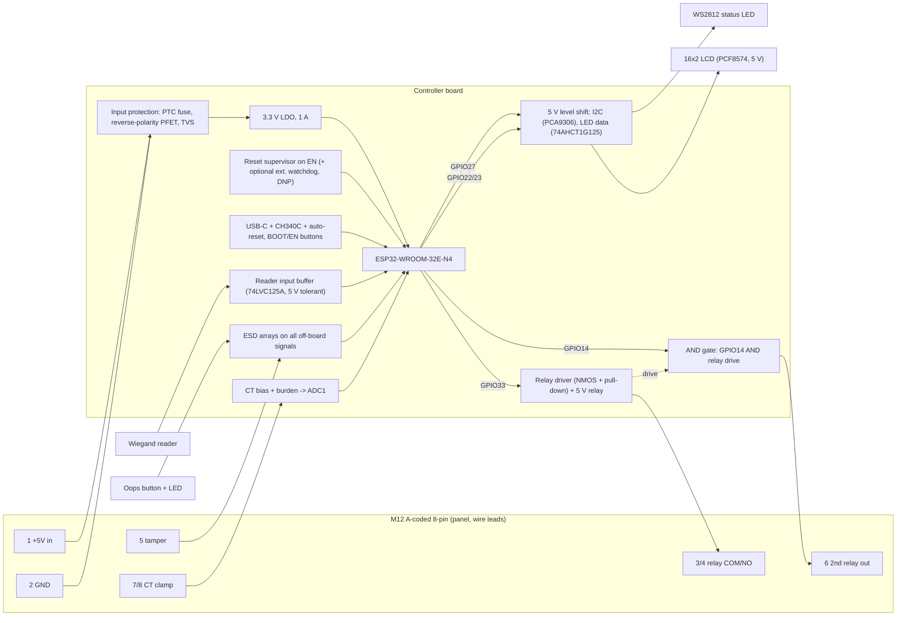

# Custom MCU PCB (V2 Hardware)

You must read, understand, and follow all instructions in `./README.md` when planning and implementing this feature.

## Overview

Research and recommend a custom PCB to replace the off-the-shelf (COTS) assembly inside the
[Version 1 MCU box](../source/hardware.rst) (ESP32 dev board on a screw-terminal breakout, level
converter, relay module, and point-to-point wiring to the reader, LCD, LED, button and M12
connector). Tracked in GitHub issue #208.

**This document is research, not a finished design.** It is written in the feature-doc format so
that, once Jason approves the recommendations, the "Implementation Plan" section below becomes the
plan for the actual board. A feature doc is a reasonable container for this: the research is the
planning phase of the feature. If Jason would rather keep research and the build plan separate, the
research sections can move to a dated `docs/YYYY-MM-DD-*.md` analysis doc like the existing
lockup analyses.

**Status:** research complete; **awaiting Jason's answers to the open questions and approval of the
recommendations before any design work.** Nothing has been ordered and no firmware or ESPHome
config has been changed.

Conventions used below:

* **[confirmed]**: verified from this repo, a datasheet, or a distributor page (cited).
* **[assumed]**: inferred, not confirmed. Each one needs checking by Jason or on a prototype.
* Prices were looked up on **2026-11-25** from the cited distributor pages; they are not estimates.

## 1. Constraints for the enclosure effort

These are stated first so the hardened enclosure for movable tools (Trello card "Design hardened
MAC MCU enclosure for movable tools") can start from them. Board numbers are targets until the
first layout is done; the enclosure should budget for the "envelope" figures, which include margin.

### 1.1 Architecture that drives the enclosure

**Recommendation: one controller board mounted to the enclosure base, with every lid-mounted part
on a keyed, latching cable.** The LCD, status LED, Oops button and RFID reader stay separate parts
mounted to the lid (as in V1) and plug into the board on JST-XH 2.5 mm headers. The M12 connector
is panel-mounted in the enclosure wall and its leads land on an 8-position pluggable terminal block
on the board.

Why, compared with putting the UI parts on the PCB and mounting the board behind the lid:

* The enclosure keeps free placement of the LCD window, button, LED and card pocket, so one board
  serves the existing V1-style box and a hardened outdoor box with a different layout.
* The RFID antenna can sit right behind the card pocket and away from the board's ground pour and
  the ESP32 antenna (see 1.5).
* The 16 mm button has a deep body behind the panel, which would collide with a board mounted
  directly behind the lid.
* Cost: a board-behind-the-lid layout needs the board to be at least as wide as the LCD plus the
  card pocket (about 170 x 100 mm), which is above JLCPCB's 100 x 100 mm price break, and it puts
  parts on both faces (LCD and LED on the front, SMT on the back), which pushes assembly to
  double-sided.

What this does not fix: there are still five cables inside the box. They are crimped, keyed and
latching instead of hand-soldered or screw-terminal joints, which removes the wiring errors and
loose-wire failures but not the cables themselves.

### 1.2 Board outline and mounting

| Item | Target | Notes |
|---|---|---|
| Board outline | 90 x 70 mm, 1.6 mm FR-4, 2 layers | [assumed] fits after layout; first layout may shrink it to about 80 x 60 mm |
| Enclosure envelope to reserve | 100 x 80 mm footprint | includes margin for cables bending off the headers |
| Mounting holes | 4 x M3 (3.2 mm plated), 4 mm from each edge | pattern 82 x 62 mm for the 90 x 70 outline; matches the M3 hardware already used in V1 |
| Height above board (component side) | 20 mm max | tallest parts are the relay (about 16 mm) and the pluggable terminal plug with wires |
| Height below board | 3 mm (THT lead stubs) | use standoffs of at least 5 mm |
| Single-sided SMT | yes | all SMT on the top face; THT connectors and relay on the top face too |
| ESP32 antenna | module antenna overhangs or sits at a board edge | keep metal, wires and the ground pour 15 mm clear of the antenna; enclosure must be non-metallic in front of it |

### 1.3 Lid parts (unchanged in size from V1)

All dimensions are from `hardware/v1_mcu/*.scad` [confirmed].

| Part | Size | Cable to board |
|---|---|---|
| 16x2 LCD with I2C backpack | 80.1 x 38.6 mm PCB, 17.5 mm total depth including backpack (`lcd.scad`) | 4-pin JST-XH (5 V, GND, SDA, SCL) |
| Wiegand RFID reader | 47.2 x 26.2 mm PCB, 25.4 mm square antenna, 4.7 mm deep (`rfid.scad`) | 5-pin JST-XH (VCC, GND, D0, D1, CST) |
| 16 mm Oops button | 16 mm panel hole (`oops_button.scad`) | 4-pin JST-XH (switch, switch return, LED+, LED-) |
| Status LED (WS2812-type) | 12 mm module as V1, or any WS2812-type pixel | 3-pin JST-XH (5 V, GND, data) |

### 1.4 External connector

**Recommendation: keep the M12 A-coded 8-pin connector and the V1 pinout**, with the box carrying
a panel-mount female socket with wire leads (as V1) rather than a PCB-mount socket. The M12 is an
industrial sensor connector with a threaded coupling ring, which survives vibration and being moved
far better than friction connectors, prewired cables are cheap and widely stocked, and every
deployed V1 junction box already has the mating cable.

Constraint this places on the enclosure: one M16 x 1.5 or Pg9 threaded panel hole (check the
chosen socket's datasheet; for example Phoenix Contact 1436343 is a rear-mount Pg9 socket with
solder cups, IP67), with a flat sealing face for the O-ring, and a protective cap on a
lanyard for movable units so an unplugged socket stays sealed.

Important rating limit: **M12 A-coded 8-pin connectors are rated 30 V and 2 A per contact** (Phoenix Contact 1436343 datasheet: IP67, 30 V, 2 A at 40 °C [confirmed]; the V1 Amazon part has no published rating and is [assumed] to be the same class).
That is a low-voltage connector. Anything switched through pins 3 and 4 must stay within that
rating; see section 5 (Load switching).

Alternatives considered:

* **GX16-8 (V1's original choice):** cheaper, but no IP rating worth relying on and the doc
  already moved away from it for cable availability.
* **M12 PCB-mount socket:** saves the pigtail, but fixes the connector to a board edge and makes the
  board position dictate the enclosure wall. Rejected for the reason in 1.1.
* **Separate mains and signal connectors (for example an IEC inlet plus M12):** only needed if the
  box ever switches mains itself, which this document recommends against.

### 1.5 RFID antenna placement

* The reader reads through the plastic lid; the card sits in the external pocket. A sealed lid is
  fine for RFID. [confirmed from V1 design: the reader is under the lid behind the card holder]
* Keep at least 25 mm between the reader antenna and any metal, including a cast-iron tool body
  behind the box, the board's ground pour, and the ESP32 module. [assumed rule of thumb for
  125 kHz readers; verify read range on a prototype mounted on a metal machine]
* The enclosure must be non-metallic (or have a non-metallic window) over the reader and in front of
  the ESP32 antenna. A die-cast aluminium "hardened" box would break both RFID and WiFi.

### 1.6 Environmental targets

| Item | Indoor (V1-style) box | Hardened / movable / outdoor box |
|---|---|---|
| IP rating | IP54 | IP65 |
| Operating ambient | 0 to +40 °C | -10 to +50 °C ambient; +70 °C inside a box in direct sun [assumed] |
| Humidity | non-condensing | condensing possible; add a vent membrane and consider conformal coat |

How these affect part choice:

* The **LCD is the weakest part for temperature**: standard 16x2 HD44780 modules are rated
  0 to +50 °C [assumed: typical HD44780 rating; no rating was given on the distributor page checked]. An outdoor unit needs an extended-temperature LCD (usually -20 to +70 °C) or should
  be shaded. All board parts in the BOM below are rated -40 to +85 °C or better.
* **IP65** needs: a gasketed lid, a sealed LCD window (glued or gasketed clear panel), an IP65 or
  better 16 mm button (the V1 button has no stated IP rating [assumed]; the V1 cover helps with
  dust but not water jets; an IP65 option is in the BOM), the M12 cap, and no open card slot (the external card pocket is fine).
* Condensation: a sealed box that heats and cools breathes moisture in. A small ePTFE vent plug and
  a conformal coat on the board are the usual fixes. Conformal coat complicates hand rework, so it
  is listed as optional for the outdoor build only.

## 2. Known problems and how the board addresses them

| # | Problem | Hardware or firmware/server? | Board's answer |
|---|---|---|---|
| 1 | Machine starts on the next login after an Oops clear because the machine's own switch was left ON (`docs/2026-11-21-oops-clear-power-on-analysis.md`) | **Hardware gap at the machine**, not the MCU | The board cannot see the machine switch while its relay is open. Real fix: NVR or magnetic switches on the machines. Board adds a current-transformer input so future firmware can detect current flowing the instant the relay closes and open it again (section 8). |
| 2 | MCUs wedged for 22 h and 40 min while WiFi-associated (`docs/2026-05-05-*` and `docs/2026-05-11-*`) | **Firmware/server** root causes, already fixed in firmware (bounded HTTP, liveness watchdog, task WDT panic) | Board adds a proper reset supervisor on EN and a footprint for an external watchdog timer, not populated by default because using it needs a firmware change (section 7). |
| 3 | Relay state at boot / brown-out | Hardware | Low-side MOSFET relay driver with a gate pull-down, so the relay is open whenever the GPIO is high-impedance (reset, boot, brown-out). Tamper input moved off strapping pin GPIO12. Second-relay output gated in hardware by the primary relay drive (section 5). |
| 4 | Hand-wired COTS stack | Hardware | One assembled board with keyed cables (section 1.1). |
| 5 | No current sensing, no tamper; second relay optional | Hardware + future firmware | Board provides tamper input, CT input and the second-relay output on the existing M12 pins; firmware for tamper and current is proposed only (section 10). |

Which parts of problem 4 are confirmed versus assumed:

* **[confirmed]** Point-to-point wiring between dev board, breakout, level converter, relay module,
  reader, LCD, LED and button (`docs/source/hardware.rst` wiring list).
* **[confirmed]** The reader needs a solder blob on `S2` for Wiegand mode, and is a single-source
  AliExpress part (same doc, note 5).
* **[confirmed]** Power is a bare 5 V feed on M12 pins 1 and 2 with no documented protection.
* **[assumed]** That these have caused field failures. Nothing in the repo records a wiring or
  power failure; the documented lockups were firmware/server. **Jason: have any units failed from
  loose wiring, the breakout terminals, or the power feed?**

## 3. Recommended architecture



Summary of the decisions (each is argued in the numbered sections that follow):

* ESP32-WROOM-32E-N4 module, same `esp32dev` ESPHome board, same GPIOs as V1 for everything the
  current config uses.
* Wiegand reader stays a separate module on a header, now with a 5 V-tolerant input buffer and a
  selectable 3.3 V / 5 V reader supply so more Wiegand readers fit.
* 16x2 PCF8574 LCD and WS2812-type LED stay; the board does the 5 V level shifting.
* One on-board relay as a low-voltage pilot contact for an external contactor/SSR; external
  contactor stays mandatory for motor loads.
* 5 V input stays, with real input protection. No mains on the board.

## 4. MCU module

**Recommendation: ESP32-WROOM-32E-N4.**

* It is the current revision of the module V1 already uses (WROOM-32D is marked "Not Recommended for New Designs" on its datasheet, v2.8 [confirmed]). Same chip
  family, same pinout, same 4 MB flash, so `board: esp32dev` and the existing config work
  unchanged. 4 MB is what V1 has today and is enough for ESPHome with OTA (two app partitions).
  [confirmed for V1 today: the deployed config builds and OTAs on 4 MB dev boards]
* ESPHome support for the classic ESP32 is the most mature of any Espressif part. [assumed: it was ESPHome's first ESP32 target; ESPHome's docs do not name the WROOM-32E with `esp32dev` explicitly, but `esp32dev` is the generic 4 MB ESP32 definition]
* Availability: Espressif's longevity commitment lists the ESP32 (classic) chip for at least 15 years from 2016-01-01 (the module is not listed separately), and LCSC showed 38,735 WROOM-32E-N4 in stock [confirmed, 2026-11-25].
* It is on JLCPCB's parts library (see BOM), so the PCB service can place it; it can also be
  hand-soldered (castellated pads) for the hand-assembly path.

Alternatives:

* **ESP32-S3-WROOM-1:** USB built in (would drop the CH340C), more RAM. But a different chip means a
  different `board:` and different GPIO capabilities, so the config would change in several places,
  against the "minimal firmware changes" constraint, and it buys nothing this application needs.
* **ESP32-C3 / C6:** cheaper, but fewer GPIOs (the design uses 13 signals plus programming pins) and
  a different config. Not worth it.

## 5. Load switching

Ratings needed are **unknown**: the repo has no list of controlled machines with voltages and
full-load amps. **Jason: please list each machine (or planned machine) with supply voltage, FLA,
and how V1 switches it today (box relay directly, external relay, contactor, SSR, coil voltage).**

**Recommendation: keep V1's design intent and make it explicit: the box's relay is a low-voltage
pilot contact only; an external contactor or SSR in a junction box switches the machine.**

* The M12 A-coded 8-pin connector is rated 30 V and 2 A per contact (section 1.4). Mains on pins 3 and 4 would be outside the
  connector's rating and would put mains in the same cable as the 5 V supply and GPIO lines. So
  the relay contact on pins 3/4 should switch only SELV: a 24 VAC/VDC contactor coil, a 5 V or
  12 V relay coil, an SSR's DC input, or a machine's own low-voltage control circuit.
  **[assumed] that no deployed unit runs mains through the M12 today; Jason please confirm.** If
  some do (for example a 120 VAC contactor coil), those junction boxes should get an interposing
  5 V relay or SSR powered from the 5 V supply already in the junction box.
* On-board relay: a 5 V coil relay rated at least 5 A, with **reinforced coil-to-contact
  insulation** (the Hongfa HF115F/005-1HS3 has 5 kV coil-contact dielectric strength, 10 mm creepage and reinforced insulation per VDE 0700/0631 [confirmed from a copy of the Hongfa datasheet, not from hongfa.com]), even though only SELV should be switched. That is cheap insurance
  against a junction box wired wrong. Add a board slot between coil and contact copper, and keep
  at least 8 mm creepage from the contact traces to anything on the logic side, so the board does
  not rely on the "SELV only" rule for safety.
* Contact rating for inductive loads: a contactor coil has an inrush of several times its holding
  current. Size the relay for that (5 A or more resistive gives margin), and fit suppression at the
  coil in the junction box: a flyback diode for DC coils, an RC snubber or MOV for AC coils.
  [assumed] that the coil inrush of the contactors in use is under the M12's 2 A per contact; this
  needs checking against the contactor datasheets once Jason lists them.
* Relay driver: AO3400A N-MOSFET low-side, 10 kΩ gate pull-down, 1N4148W flyback across the coil.
  The relay is open whenever GPIO33 is not actively driven high: during reset, during boot (all
  GPIOs come up as inputs), in brown-out reset, and with the ESP32 removed or unpowered.
  GPIO33 is not a strapping pin. Espressif's IO_MUX table (ESP32 datasheet, Appendix A) shows GPIO33 with output and input disabled and no pull at and after reset [confirmed].
* SSR on board: rejected. A triac SSR leaks current when off (an "off" machine can still have a
  few mA on its terminals), needs a heatsink above a few amps, and puts mains on the board.
* **Second relay (M12 pin 6):** V1 wires GPIO14 straight to pin 6 as a 3.3 V logic output that
  drives an external relay module. V2 keeps pin 6 as a 3.3 V logic output so existing second-relay
  junction boxes still work, but drives it through a 74LVC1G08 AND gate whose inputs are GPIO14
  and the primary relay drive, with a series resistor and ESD clamp on the output. That enforces in
  hardware what the server already does (the second relay only energizes while the primary relay
  does), and it masks anything GPIO14 does during boot while GPIO33 is low. Espressif's IO_MUX table shows GPIO14 with its weak pull-up **enabled** after reset until firmware configures the pin [confirmed], so on V1 the external relay module on pin 6 sees a weakly pulled-up line during boot; whether that is enough to trigger a given module is [assumed] and should be scoped on a V1 unit. The often-repeated "GPIO14 outputs PWM at boot" claim has no Espressif source that could be found.
  No firmware change.

What the relay does on any reset: **it opens.** With a normal (non-latching) relay there is no
way to keep a load on through an ESP32 reset without adding a hold circuit, and the constitution
requires relays to default off. The firmware already avoids self-reboots while the relay is on
(the liveness watchdog defers), so a reset that drops the load only happens when the firmware is
too wedged to run its own watchdog, and in that state the Oops button does not work either. See
section 7.

## 6. Power input

**Recommendation: keep an external 5 V supply via M12 pins 1 and 2. No mains on the board.**

* Mains on the board would mean: mains creepage and clearance on the board, a fuse and probably a
  certified PSU module, an earth-bonded or double-insulated enclosure rated for mains, and mains in
  the box next to a reader the user touches. V1 already has a 5 V supply in the junction box (or
  uses the machine's own supply), so there is no gain worth that.
* Wide-input (for example 12 or 24 V via a buck converter) was considered, because many machines
  have 24 V control supplies. It would change the meaning of M12 pin 1 for every deployed junction
  box, so it is listed as an open question rather than recommended.
* 3.3 V rail: a 1 A LDO (AP7361C-33) from 5 V. The ESP32 draws up to about 500 mA in WiFi
  transmit bursts [confirmed, Espressif datasheet]; AMS1117 is cheaper but its 1.1 V dropout
  leaves little margin once the input protection drops a few hundred mV, so it is not
  recommended.
* 5 V budget [assumed, to measure on a prototype]: ESP32 about 250 mA average, LCD backlight about
  30 mA, relay coil about 80 mA (HF115F 5 V coil, 62 Ω), WS2812 up to 60 mA at full white, reader about 50 mA. Under
  0.5 A in total, well within V1's 2.5 A supply and the M12's 2 A per contact.

## 7. Protection, reset and watchdog

Input (M12 pins 1/2):

* PTC resettable fuse, 1.1 A hold (1812).
* Reverse-polarity protection: AO3401A P-MOSFET (lower drop than a Schottky diode).
* TVS diode, SMBJ5.0A, after the fuse.
* Bulk capacitance (47 to 100 µF) plus a ferrite on the 5 V rail feeding the relay coil, to keep
  relay switching and motor noise away from the 3.3 V LDO.

Signals:

* ESD arrays (SRV05-4 or similar) on every off-board signal: reader D0/D1/CST, button switch and
  LED, LED data, I2C, M12 pins 5, 6, 7, 8.
* Series resistors (about 100 to 330 Ω) on off-board inputs so the ESD diodes are not the only
  current limit.
* The relay contact side (M12 pins 3/4) is isolated from logic by the relay itself and the board
  slot; no ESD parts on it.

Reset and brown-out:

* ESP32 internal brown-out detector stays on (ESPHome default) [assumed default, verify].
* **Voltage supervisor on EN** (APX803-class, about 2.9 to 3.1 V threshold) instead of the usual
  RC on EN. The plain RC is known to give unreliable starts on slowly rising supplies such as a
  long cable or a soft-start supply [assumed from common ESP32 practice]. The supervisor holds the
  chip in reset until 3.3 V is good and resets it cleanly on a sag.

External watchdog (problem 2):

* The lockups in the analysis docs were the main loop stuck inside an HTTP call that kept feeding
  the task watchdog. The firmware now bounds that call and panics the task WDT (60 s), and enables
  the RTC watchdog. An external watchdog would add an independent check that the ESPHome main loop
  is alive, in case the on-chip watchdogs are ever misconfigured again.
* The case it covers is "loop dead", and in that case the Oops button and LCD are dead too, so
  resetting and dropping the relay is the safe outcome. The case where Bronte deliberately kept its
  relay on mid-cut was "loop alive, server unreachable", which the firmware handles and the
  external watchdog would never see, as long as it is kicked from the main loop.
* **Recommendation: footprint only, not populated by default.** A TPL5010 timer (resistor-set
  timeout) with its reset output into EN, a timeout of about 120 s (longer than the 60 s task WDT,
  so the on-chip watchdog fires first), kicked from a spare GPIO (GPIO25) by an ESPHome
  `interval:`. Populating it needs that firmware change, which is out of scope here. A DNP
  resistor in the reset path keeps it from doing anything until it is deliberately enabled.
* EN reset is enough; a full power cycle of the board is not needed, because an EN reset restarts
  the ESP32 exactly as a power cycle does and the LCD/reader recover on their own [assumed, the
  analysis docs recovered with power cycles, never EN resets; verify on a prototype].

## 8. Current sensing and the "machine switch left ON" problem

* **The board cannot detect the machine switch position while its relay is open**, because no
  current flows and the board (by design) sees no mains. The only pre-emptive fixes are at the
  machine: an NVR (no-volt release) paddle switch or a magnetic starter, which drops out when power
  is removed and so cannot be "left ON", or an auxiliary contact on the machine switch wired back
  to an input. NVR switches are the standard practice and the recommendation for problem 1.
* What a current input adds: after the relay closes on a login, firmware can see current within a
  few hundred ms. Firmware could then open the relay and show "turn machine switch off" if current
  appears before the operator presses start. The motor would still twitch. That is a mitigation,
  not a fix.
* **Recommendation: include the CT input now, firmware later.** It is a handful of passives: a
  burden resistor (or none, for a voltage-output CT), a 1.65 V mid-rail bias, an RC filter and an
  ESD clamp, into ADC1 on GPIO36 (ADC2 cannot be used with WiFi on). ADC1 is GPIO32 to 39 per the ESP-IDF GPIO docs [confirmed].. Sensor: a split-core
  voltage-output CT such as the YHDC SCT-013-030 (30 A, 1 V output) clamped on one machine
  conductor inside the junction box, wired to M12 pins 7 and 8. ESPHome supports this through the
  `ct_clamp` sensor platform. [confirmed: https://esphome.io/components/sensor/ct_clamp/; reads an `adc` sensor, needs `attenuation` set because the ESP32 ADC tops out near 1.1 V by default]
* `esphome-configs/` has only `no-current-input.yaml`; a future `current-input.yaml` would add
  the `ct_clamp` sensor (section 10). No current-input config exists today [confirmed].

## 9. Programming and debug

* **USB-C with a CH340C USB-UART and the standard two-transistor auto-reset circuit**, plus BOOT and
  EN tactile buttons. First flash and serial logs need nothing but a USB-C cable. USB VBUS feeds the
  5 V rail through a Schottky diode so a board can be flashed and bench-tested without M12 power,
  and so USB cannot back-feed a junction box supply.
* A 2.54 mm header with TX, RX, GND, 3.3 V, EN, GPIO0 for an external adapter or logic analyzer.
* **OTA stays the production path** (`ota: platform: esphome` in the config, see
  `docs/source/hardware.rst` ESPHome section). USB is for first flash and bench work only; the USB
  connector is inside the box.

## 10. Firmware compatibility (pin map)

Every pin the current config (`esphome-configs/2025.11.2/no-current-input.yaml`) uses stays on the
same GPIO, so **the existing config works unchanged** on the V2 board.

| Function | V1 GPIO | V2 GPIO | Change |
|---|---|---|---|
| Wiegand D0 | 16 | 16 | none (through 5 V-tolerant buffer) |
| Wiegand D1 | 4 | 4 | none (through buffer) |
| Card present (CST) | 18 | 18 | none (through buffer) |
| LCD SDA / SCL | 22 / 23 | 22 / 23 | none (PCA9306 replaces the level converter) |
| Status LED data | 27 | 27 | none (74AHCT1G125 replaces the level converter) |
| Oops button | 32 | 32 | none (internal pull-up still used; V1 wires the switch's NC contact, so an unplugged button cable reads as "Oops pressed", and V2 keeps that) |
| Oops LED | 5 | 5 | none |
| Primary relay | 33 | 33 | none |
| Second relay (M12 pin 6) | 14 | 14 | none; output now ANDed with the relay drive in hardware |
| Tamper (M12 pin 5) | 12 | **35** | moved off strapping pin GPIO12; not used by any config today |
| CT clamp (M12 pins 7/8) | none | **36** | new; not used by any config today |
| External watchdog kick | none | **25** | new; only if the DNP watchdog is fitted |

Why GPIO12 must move: GPIO12 (MTDI) is a strapping pin that sets the flash voltage at reset. A
tamper switch with a pull-up that holds it high during reset selects 1.8 V flash on a module whose
flash needs 3.3 V, and the board fails to boot. (ESP32 datasheet section 3.2; the WROOM-32E datasheet says "IO12 should be kept low when the module is powered on" [confirmed]; that a high level stops the board booting is an inference from the 1.8 V flash supply, not a quoted Espressif statement). GPIO35 is input-only with no internal
pull-up, so the board adds an external 10 kΩ pull-up.

Status LED colour order: the V1 config sets `rgb_order: RGB` because V1 uses LEDs cut from a
string. A genuine WS2812B is GRB. Builders who use a WS2812B on the LED header need
`rgb_order: GRB`; this is a property of the LED, not the board.

Proposed config additions for later (**proposal only, not applied to any config**):

```yaml
binary_sensor:
  - platform: gpio
    pin: GPIO35          # tamper switch, M12 pin 5; external pull-up on the V2 board
    name: "Tamper"
    id: tamper
    device_class: tamper

sensor:
  - platform: adc
    pin: GPIO36          # CT clamp, M12 pins 7/8, biased to mid-rail on the V2 board
    id: ct_adc
    attenuation: 12db
    update_interval: never
  - platform: ct_clamp
    sensor: ct_adc
    name: "Machine Current"
    sample_duration: 200ms
    update_interval: 2s
```

## 11. Draft BOM

Prices looked up 2026-11-25. "Board BOM" means parts on the controller board; lid parts, M12
connector and enclosure carry over from V1 unchanged.

Unit prices are LCSC's price at its quantity-10 break, or the nearest break when 10 is not one
(noted). "Class" is the JLCPCB assembly library class: Basic parts have no loading fee, each
unique Extended part has one. Source URL pattern: `https://www.lcsc.com/product-detail/<LCSC#>.html`.

### Controller board

| Ref | Function | Manufacturer / MPN | LCSC # | Qty | Unit (USD) | Class |
|---|---|---|---|---|---|---|
| U1 | MCU module | Espressif ESP32-WROOM-32E-N4 | C701341 | 1 | 3.3129 | Extended |
| U2 | USB-UART | WCH CH340C | C84681 | 1 | 0.4594 | Extended |
| J1 | USB-C receptacle | Korean Hroparts TYPE-C-31-M-12 | C165948 | 1 | 0.1888 (qty 5 break) | Extended |
| U3 | 3.3 V 1 A LDO | Diodes AP7361C-33E-13 | C500795 | 1 | 0.8833 | Extended |
| U4 | Reset supervisor, 2.93 V, open drain | Diodes APX803S-29SA-7 | C143831 | 1 | 0.2862 | Extended |
| U5 | External watchdog timer (**DNP**) | TI TPL5010DDCR | C473912 | 0 | 0.2727 | Extended |
| K1 | Relay, 5 V coil, 10 A 250 VAC, reinforced | Hongfa HF115F/005-1HS3 | C81373 | 1 | 1.9224 | Extended (THT) |
| Q1 | Relay driver | AOS AO3400A | C20917 | 1 | 0.0786 (qty 5 break) | Basic |
| Q2 | Reverse-polarity PFET | AOS AO3401A | C15127 | 1 | 0.0827 (qty 5 break) | Basic |
| D1, D2 | Relay flyback, misc. | JSCJ 1N4148WS | C2128 | 2 | 0.0098 (qty 50 break) | Basic |
| U6 | 2nd-relay AND gate | SN74LVC1G08DBVR (UMW) | C434068 | 1 | 0.0421 | Extended |
| U7 | LED data 3.3 → 5 V | TI SN74AHCT1G125DBVR | C7484 | 1 | 0.1109 (qty 5 break) | Extended |
| U8 | I2C 3.3 ↔ 5 V | TI PCA9306DCTR | C123752 | 1 | 0.3762 (qty 5 break) | Extended |
| U9 | Reader input buffer | TI SN74LVC125APWR | C7813 | 1 | 0.3518 (qty 5 break) | Extended |
| D3 | Input TVS | MDD SMBJ5.0A | C113974 | 1 | 0.0592 | Extended |
| U10-U12 | ESD arrays (12 lines) | Protek SRV05-4-P-T7 | C85364 | 3 | 0.2214 (qty 5 break) | Extended |
| F1 | PTC fuse, 1.1 A hold | Littelfuse 1812L110PR | C163516 | 1 | 0.0529 | Extended |
| J2-J4 | LCD, button, LED headers (LED uses pin 4 as a spare GND) | JST B4B-XH-A(LF)(SN) | C144395 | 3 | 0.0522 | Extended (THT) |
| J5 | Reader header | JST B5B-XH-A(LF)(SN) | C157991 | 1 | 0.091 (qty 5 break) | Extended (THT) |
| J6 | M12 lead terminal, plug half | Cixi Kefa KF2EDGK-3.81-8P | C440864 | 1 | 0.4448 | Extended (THT) |
| SW1, SW2 | BOOT, EN buttons | XKB TS-1187A-B-A-B | C318884 | 2 | 0.0198 (qty 20 break) | Basic |
| (passives) | about 40 resistors and capacitors | e.g. UNI-ROYAL 0603 1 k/10 k (C21190/C25804), 100 nF 0603 (C14663), 10 µF 0805 (C15850) | | 40 | 0.0015 to 0.0311 | Basic |
| | **Priced subtotal per board** | | | | **9.62 + at most 1.24 passives = 10.86** | |

Not yet priced (small parts, to price at schematic time): the PCB header half of the 8-position
3.81 mm terminal (KF2EDGR/KF2EDGV, not found on LCSC), two auto-reset NPN transistors, the USB
VBUS Schottky, the 5 V bulk capacitor and the ferrite bead. The passive line uses 40 times the
most expensive passive priced, as an upper bound.

AP7361C vs AMS1117-3.3: the AMS1117-3.3 (C6186, $0.2032, **Basic**) would save about $0.68 per
board plus one $3.07 loading fee per order, but its 1.1 V dropout is too close to the margin
after input protection (section 6). Kept AP7361C.

### Carried over from V1 (unchanged)

| Item | Price | Source |
|---|---|---|
| 16x2 LCD with PCF8574 I2C backpack | $3.99 | V1 table, November 2025, **not re-checked** (no current PCF8574-backpack listing found at a distributor; Adafruit's 16x2 LCD alone is $8.96 at qty 10, adafruit.com/product/181, 2026-11-25) |
| Wiegand RFID reader | $6.26 | V1 table, November 2025, **not re-checked** (AliExpress) |
| 16 mm Oops button + cover | $5.49 | V1 table, November 2025, **not re-checked** |
| WS2812-type LED | $0.32 | V1 table, November 2025, **not re-checked** |
| M12 8-pin socket + 2 m cable | $9.80 + ~$15.49 | V1 table, November 2025, **not re-checked**; no verified US distributor price found on 2026-11-25 for the Phoenix Contact 1436343 Pg9 socket (EUR snippets only) |
| Enclosure + card holder | $9.90 | V1 table |

Options for the hardened outdoor build:

| Item | Price | Source |
|---|---|---|
| IP65 16 mm LED pushbutton, Olimex BUTTON-16MM-RED (LED 3 to 5 V) | EUR 1.80 at 10+ | olimex.com product page, from a search snippet, **unverified** |
| Adafruit 558 16 mm LED pushbutton (3 to 6 V LED; gasket, no IP rating) | $4.46 at 10 | adafruit.com/products/558, 2026-11-25 |
| YHDC SCT-013-030 CT (30 A, 1 V out), only when current sensing is wanted | $12.90 to $15.33 | retailer search snippets, **unverified**; no DigiKey/Adafruit listing found |

## 12. DFM, ordering and cost

* **Board:** 2 layers, 1.6 mm FR-4, HASL, about 100 x 80 mm or smaller, single panel per board (no
  panelization needed at these quantities; JLCPCB's price is per board up to 100 x 100 mm).
* **Assembly:** JLCPCB **Economic** PCBA, single-sided. All SMT on one face. Through-hole parts
  (relay, JST headers, terminal header) are either added by JLCPCB's hand-soldering service or
  soldered by us; both keep a hand-solder path, and a fully hand-built board is possible because
  the ESP32 module has castellated pads and every SMT part is 0603, SOT-23, SOIC or TSSOP.
* **Extended parts:** 12 unique SMT Extended part types (U1-U4, J1, U6-U9, D3, F1, and the SRV05-4 used three times), each
  with a $3.07 loading fee per order on Economic PCBA ([assumed] per unique part; JLCPCB's page
  does not say so explicitly). Swapping parts to Basic equivalents is the main lever on small-batch
  cost; it is a schematic-time decision.
* **JLCPCB published fees** (jlcpcb.com/help/article/pcb-assembly-price, updated 2026-10-22,
  read 2026-11-25): Economic setup $8.18, stencil $1.53, $0.0016 per SMT joint, $3.07 per
  Extended part, $0.45 parts-placement confirmation, $3.58 hand-soldering labor per order.
* **PCB quote** (cart.jlcpcb.com/quote, 100 x 80 mm, page defaults, 2026-11-25): $4.00 for 5,
  $5.00 for 10 (both marked "Special Offer"), $19.40 for 20. UPS shipping shown as $25.99.
  The 2-layer / 1.6 mm defaults were [assumed], not re-checked on the form.
* **Lead time:** not looked up for this order shape; JLCPCB's Economic PCBA is typically days
  plus shipping [assumed]. Get the real figure with the live quote in Milestone 2.
* **Supply risk:** the RFID reader (single AliExpress source) is the only part with real supply
  risk; the board's 5 V-tolerant reader input and 5 V reader supply are there so a different
  Wiegand reader with a card-present output can replace it. The ESP32-WROOM-32E has a long
  longevity commitment and deep stock. The M12 socket and cables are multi-source.

### Cost comparison with V1

V2 replaces only these V1 items: ESP32 dev board $5.66, screw-terminal breakout $8.13, level
converter $0.75, relay module $1.29, a total of **$15.83** (V1 table, November 2025 prices, not
re-checked). Everything else in the $67.08 control box carries over.

Rough V2 controller board cost, from the prices above (qty-10 LCSC prices used for both
quantities, which overstates the 20-board case slightly; about 250 SMT joints per board
[assumed]):

| Line | 10 boards | 20 boards |
|---|---|---|
| PCBs | $5.00 | $19.40 |
| Economic PCBA setup + stencil + placement confirmation | $10.16 | $10.16 |
| Extended-part loading fees (12 × $3.07) | $36.84 | $36.84 |
| SMT joints (250 × $0.0016 per board) | $4.00 | $8.00 |
| Board parts ($10.86 per board) | $108.60 | $217.20 |
| Shipping (quoted UPS) | $25.99 | $25.99 |
| **Total** | **$190.59** | **$317.59** |
| **Per board** | **$19.06** | **$15.88** |

Not included: the unpriced small parts listed under the BOM, THT soldering (our time, or
JLCPCB's $3.58 per order plus per-joint fees), tariffs/duties, and any CT clamp.

So, per control box:

| | V1 | V2 at 10 | V2 at 20 |
|---|---|---|---|
| Replaced electronics | $15.83 | $19.06 | $15.88 |
| Control box total | $67.08 | about $70.31 | about $67.13 |

**Conclusion: V2 is roughly cost-neutral, not a saving.** The case for it is repeatable assembly,
input and ESD protection, a fail-safe relay driver, the GPIO12 boot fix, and the tamper/CT inputs,
not cost. The fixed fees dominate at these quantities, so ordering 20 instead of 10 costs about
$127 more for 10 extra boards. At the confirmed count of four units, 10 boards leaves six spares.

## 13. Safety and compliance notes for mains switching

These are research notes on common practice, **not a certification or compliance claim**.

* **The external contactor stays mandatory** for motors and any load above the pilot relay's
  rating. The box never carries mains (section 5 and 6).
* Junction box: a listed enclosure (V1 uses a Carlon PVC box), with cord grips or strain reliefs on
  every cable, the machine's equipment-grounding conductor carried through and bonded, and
  contactors and supplies that are UL-recognized/listed parts rated for the load voltage and the
  motor's FLA (motor-rated, AC-3 or HP-rated contacts).
* Switch every ungrounded conductor: both legs for 240 V machines (V1's 2-pole contactor option
  already does this), the hot (never the neutral) for 120 V.
* Overcurrent protection: the branch circuit protects the cord and contactor; the box's 5 V supply
  is protected by its own internal fuse; a separate fuse on the 5 V supply's mains input is good
  practice for supplies without one.
* Clearance and creepage on any board that does carry mains: about 3 mm clearance and 4 mm creepage
  for basic insulation at 250 VAC, doubled for reinforced (from IEC 60664-1 tables, pollution
  degree 2; check the exact figures before relying on them). This is why the recommendation keeps
  mains off the board entirely.
* Labeling: label the junction box "controlled by access control; disconnect machine plug or
  breaker before servicing", and label the machine with how to clear an Oops. The access-control
  relay is **not** a lockout/tagout disconnect and must not be used as one.
* The access-control relay is also not an emergency stop. The Oops button is a request to the
  server, not a safety-rated stop; machines that need an E-stop keep their own.

## 14. Open questions for Jason

1. **Unit count:** how many MAC units are in production now, and how many are planned? The repo's
   `machines.json` is a test stub; the analysis docs name four. Board quantities in section 12 use
   10 and 20 boards (the four units named in the analysis docs plus spares and growth) [assumed] until this is answered.
2. **Machine list:** voltage, FLA, and current switching method (box relay direct, external relay,
   contactor and its coil voltage, SSR) for each machine.
3. **Mains on M12:** does any deployed unit run mains (for example a 120 VAC contactor coil) through
   M12 pins 3/4?
4. **Field failures:** have any V1 units failed from wiring, the screw-terminal breakout, or the
   power feed (problem 4 is otherwise assumed)?
5. **Fob technology:** are the Neon fobs 125 kHz (EM4100-type)? That decides whether a 13.56 MHz
   reader (PN532, which ESPHome supports with tag-removed events) is even an option later.
6. **Reader supply:** is the V1 AliExpress reader still orderable? If not, a 5 V Wiegand reader with
   a card-present output is the fallback, which is why the board offers a 5 V reader supply.
7. **Wide-input power:** worth accepting 12/24 V on M12 pin 1 in a future revision, given that it
   changes every junction box?
8. **Outdoor scope:** which movable tools are going outdoors, and do they need IP65 or is IP54 with
   shade enough? This decides the LCD and button choice.
9. **Approval:** approve the recommendations (base-mounted board, keep M12 and pinout, ESP32-WROOM-32E,
   pilot relay only, 5 V input, CT input and DNP watchdog footprints) so the implementation plan
   below can start?
10. **Hardware layout:** OK to create `hardware/v2_mcu/` holding a KiCad project (schematic, PCB,
    JLCPCB BOM/CPL exports, and a README) alongside the existing `hardware/v1_mcu/`?

## Implementation Plan

Proposed only; not started. Per `docs/features/README.md`, each milestone needs Jason's approval
before moving to the next. Commit prefix: `Custom MCU PCB - {Milestone}.{Task}`.

### Milestone 1: Schematic

* 1.1 Create `hardware/v2_mcu/` KiCad project and README (after question 10 is answered).
* 1.2 Schematic per sections 3 to 10, with LCSC part numbers on every SMT part.
* 1.3 Review: fresh reviewer checks pin map against the ESPHome config and the fail-safe relay path.

### Milestone 2: Layout and order files

* 2.1 Board outline and mounting per section 1.2; confirm the final outline back to the enclosure
  effort.
* 2.2 Layout, DRC, JLCPCB BOM/CPL export.
* 2.3 Get a live JLCPCB quote; **Jason approves before any order is placed.**

### Milestone 3: Prototype bring-up

* 3.1 Flash the existing `hardware-test.yaml` and `no-current-input.yaml` unchanged; run
  `esphome-configs/2025.11.2/hardware-test.md`.
* 3.2 Measure: relay state through power-up, EN reset, brown-out (variable supply) and with
  GPIO14 toggled; 5 V current budget; RFID read range on a metal machine.
* 3.3 Fix-ups and a second revision if needed.

### Milestone 4: Acceptance Criteria

* 4.1 Update `docs/source/hardware.rst` with a Version 2 section (components, wiring, pinout).
* 4.2 Update `CLAUDE.md` if anything in it changes.
* 4.3 All nox sessions pass (no server code changes are expected).
* 4.4 Move this file to `docs/features/completed/`.
